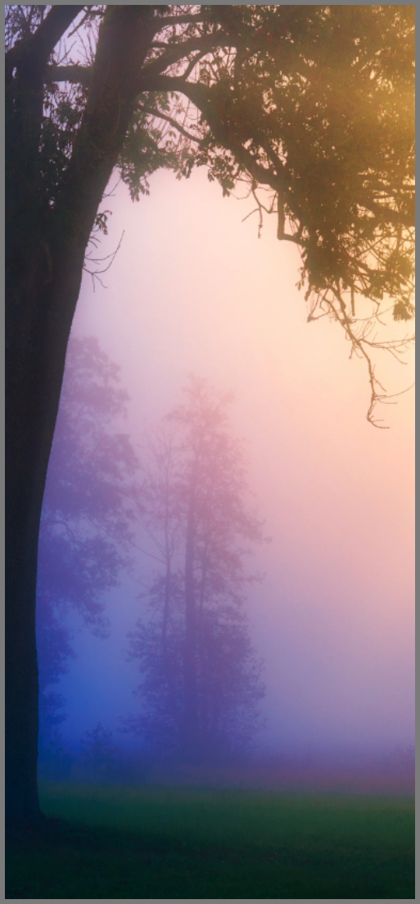

# Photo Widget

A responsive and dynamic home-screen photo widget for Omalauncher with multi-photo slideshow fade transitions, multi-widget duplication, and dynamic theme adaptation.

## Features

- **Multi-Photo Slideshow & Smooth Fade Transition**: Support adding multiple photos per widget (up to 10 photos in album) with customizable crossfade intervals (5s, 8s, 15s, 30s, 1m).
- **Dynamic Theme Adaptation**: Automatically senses active Omarchy light and dark themes, adjusting cards, buttons, borders, and contrast for seamless aesthetic harmony.
- **Multi-Widget Management**: Add up to 10 independent photo widget instances on the home screen, each with its own photo or slideshow configuration.
- **Dynamic Box Layout**: Edge-to-edge photo display that fills any grid dimensions (2x2, 3x3, 4x3, 3x6, etc.) without letterbox borders. Supports both Cover and Contain fit modes.
- **Embedded Offline Default**: Includes an embedded base64 default photo, working instantly out of the box without requiring initial setup or internet connection.
- **Multi-Source Support**:
  - Direct web image URLs (HTTP / HTTPS).
  - Cloud share links with automatic direct-link resolution (Google Drive, Dropbox, Imgur).
  - Android device storage (`/storage/...`, `~/Pictures`).
- **Interactive Configuration**: Tap the widget to open a full-screen sheet with real-time download status, high-resolution preview, and quick access to device pictures.

## Requirements

Declared in `requires`:
- `python`
- `python-pillow`
- `curl`

## Author

Created by [zyanmd](https://github.com/zyanmd). Distributed under the MIT license.
